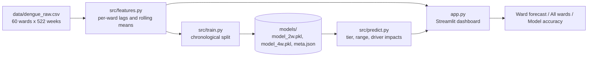

# Architecture

## 1. Data flow

1. **Ingest:** the raw weekly CSV (temperature, humidity, rainfall, ward attributes, cases) is read once.
2. **Features:** `build_features` sorts by ward and date, then computes everything inside each `ward_id` group so
   one ward's history never leaks into another.
3. **Train:** two models are trained (cases in 2 weeks, cases in 4 weeks) and saved with `joblib`.
4. **Serve:** the app loads the saved models once, builds features once, and answers every click from memory.

## 2. Weather lag features

Dengue follows rain with a delay (egg-to-adult 7-14 days plus incubation), so the models see the past, not just today:

- Rainfall this week and exactly 1, 2, 3 and 4 weeks ago (`rain_lag_0w` ... `rain_lag_4w`) and total rain over 4 weeks.
- Average temperature and humidity over the last 2 and 4 weeks.
- Ward vulnerability: population density, water-logging risk index, sanitation score.
- Month of year, so the model can learn the July-September season.
- Dengue case counts are deliberately **not** used as inputs: a test without them scored the same, and
  weather-only inputs mean the system works where case reports are late or missing.

Targets are future cases (`shift(-2)` and `shift(-4)` within each ward).

## 3. Chronological validation split

- **Train:** weeks before 2024-01-01 (2016-2023, about 24,800 rows per model).
- **Test:** 2024-01-01 onward (about 6,100 rows), never seen in training.
- No random shuffling: random splits would put neighbouring weeks on both sides and overstate accuracy.
- Risk-tier cut-offs (75th / 90th / 95th percentile of weekly cases = Medium / High / Critical) and the "typical
  value" used for driver explanations are computed from the training years only.

| Horizon | MAE | RMSE | Guess-the-average MAE |
|---|---|---|---|
| 2 weeks | 1.12 | 2.23 | 3.14 |
| 4 weeks | 1.32 | 2.54 | 3.14 |

## 4. Model selection

A `RandomForestRegressor` (100 trees, depth 12, min 5 samples per leaf) was chosen because it:

- captures non-linear and interacting effects (rain matters more in a poorly drained, crowded ward) without feature scaling;
- copes with the many zero-case weeks outside the season;
- gives an uncertainty range for free (spread across trees) and a fast, small serialized file (about 3 MB each);
- is simple to explain to public-health staff.

It beats the guess-the-average baseline by a wide margin. Other model families (for example gradient boosting)
have not been benchmarked yet and are planned for the onsite round.

## 5. Compute and API cost controls

- **Serialized models:** `joblib` files with compression (about 3 MB each, loaded in well under a second).
- **Cached resources:** `st.cache_resource` loads models once per server; `st.cache_data` builds features once and
  caches all-ward predictions per (week, horizon). Changing a ward or tab never recomputes features.
- **Batching:** the all-ward ranking is one model call on 60 rows; driver impacts are one call on 15 rows.
- **No external calls at runtime:** no weather API, no LLM, so zero token cost and no rate limits. When live weather
  is added, plan: one fetch per day, cached on disk, and reuse of the same feature pipeline.
- **Training only when needed:** about 20 seconds on a laptop; the app retrains automatically only if saved models
  are missing or incompatible.

## 6. Known limitations

- Peaks are under-predicted: exact tier is right 85% / 83% of the time, and the worst weeks are often labelled
  Medium instead of Critical. All High and Critical test weeks were still flagged Medium or above, so Medium is a
  sensible early-warning trigger.
- Driver bars are an approximation (each input swapped for its typical value), not exact causal effects.
- Input is the supplied historical weekly dataset; live weather ingestion is future work.
