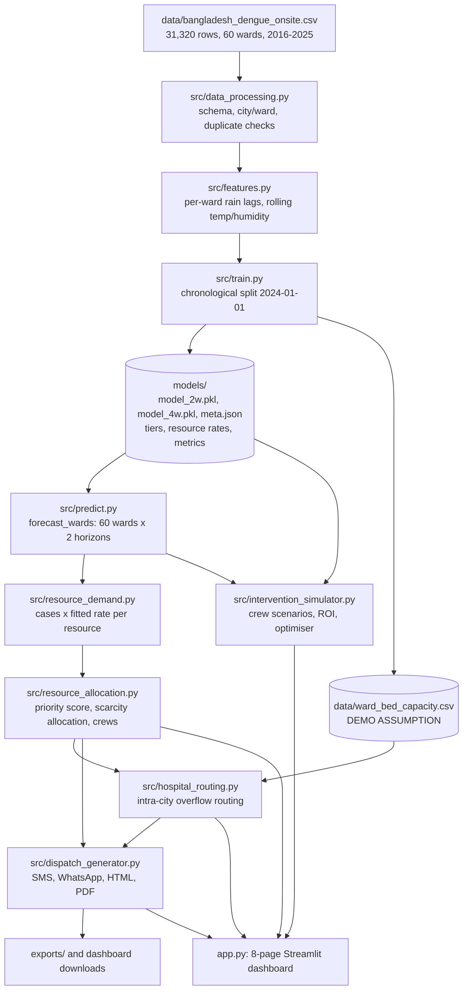

# Architecture

Phase 1 built a 2-week / 4-week dengue forecaster. Phase 2 keeps that forecaster unchanged in method and adds four
operational modules plus an offline guarantee on top of it, inside the same repository and Streamlit app.

## 1. Data flow



`src/pipeline.py` wraps forecast → demand → allocation → routing in one function, `run_plan()`, which the
dashboard, `generate_exports.py`, `offline_check.py` and the tests all call. There is one implementation of each
rule, so the numbers on screen, in the notices and in the tests cannot drift apart.

```text
Updated onsite dataset
        |
Preprocessing, validation, feature engineering
        |
Random Forest forecasts (2-week, 4-week)
        |
        +----------------------+----------------------+
        |                      |                      |
 Resource allocation   Hospital overflow      Vector-control
 (stock %, crews)      routing (same city)    simulator (ROI)
        |                      |                      |
        +----------------------+----------------------+
                               |
                Dispatch generator: SMS / WhatsApp / HTML / PDF
                               |
                     Operational dashboard
All of it runs from local files: no internet, no LLM.
```

## 2. Dataset integration

- The onsite CSV is copied unchanged to `data/bangladesh_dengue_onsite.csv`. Its first 12 columns match the
  Phase 1 `data/dengue_raw.csv` exactly (checked cell by cell), so the Phase 1 features and models carry over.
- `validate()` checks the 15 required columns, parseable dates, numeric types, no negative counts, the
  5-city / 60-ward structure (20/20/10/5/5), that no ward belongs to two cities, and no duplicate (date, ward) rows.
  Result for the supplied file: 0 missing values, 0 duplicate rows.
- No cleaning was needed. The only transformation is lowercasing column names (a no-op for this file; Phase 1's
  file used `avg_temp_C`).

## 3. Forecasting pipeline and chronological validation

Features (all computed inside each `ward_id` group so one ward never leaks into another):

- Rainfall this week and exactly 1, 2, 3, 4 weeks ago, and the 4-week rain total. Dengue follows rain with a delay
  (standing water, egg-to-adult development, then human incubation), so lagged rain carries signal current rain does not.
- Mean temperature and humidity over the last 2 and 4 weeks; ward density, water-logging risk, sanitation; month.
- Targets: `dengue_cases` shifted 2 and 4 weeks forward within the ward.

Leakage controls:

- Every feature at origin week *t* uses data from weeks ≤ *t* only (`shift(k)` with k ≥ 0, trailing rolling windows).
- Split by origin date: train on origin weeks before 2024-01-01 (24,780 rows), test on 2024-2025 (6,180 rows at 2 weeks,
  6,060 at 4 weeks). No shuffling. The last training origin week is 2023-12-25, whose 4-week target falls in January
  2024; this touches the test period by at most 4 weeks of targets and is the usual direct-forecast convention.
- Risk-tier cut-offs (75th / 90th / 95th percentile of weekly cases: 4, 10, 13), the driver "typical values" and the
  resource rates are computed from training years only.
- The resource columns are never features. Neither is `dengue_cases` itself (see below).

| Horizon | MAE | RMSE | R² | Persistence MAE / R² | Mean-guess MAE |
|---|---|---|---|---|---|
| 2 weeks | 1.119 | 2.225 | 0.672 | 1.691 / 0.266 | 3.135 |
| 4 weeks | 1.324 | 2.538 | 0.579 | 2.136 / -0.007 | 3.143 |

Persistence ("cases in h weeks = cases this week") is the natural operational baseline; the model beats it clearly
at both horizons. Exact tier accuracy is 84.7% / 82.9%; High or Critical weeks flagged Medium or above: 100% at
2 weeks, 90.4% at 4 weeks.

**Model choice.** In Phase 1, six algorithms were compared on the same features and split (Ridge MAE 1.53 / 1.92,
decision tree 1.27 / 1.38, random forest 1.12 / 1.32, extra trees 1.08 / 1.32, gradient boosting 1.08 / 1.39,
Poisson gradient boosting 1.04 / 1.33; that experiment script is not in the repo). Tree ensembles clearly beat
linear and single-tree models; the ensembles were close. The Random Forest was kept because it handles non-linear
interactions without scaling, copes with many zero weeks, gives a per-forecast spread across trees (used for the
range and the Cautious demand basis) and is easy to explain.

**Case-lag check (Phase 2).** Adding cases this week and 1-3 weeks ago plus a 4-week case mean improved MAE only
from 1.119 to 1.115 (2 weeks) and 1.324 to 1.314 (4 weeks), with R² 0.677 / 0.587. The gain is too small to give up
the property that forecasts still work when case reporting is late, so the weather-only models were kept.

Artifacts: `models/model_2w.pkl`, `model_4w.pkl` (joblib, compressed) and `meta.json` (tiers, metrics, validation
dates, resource rates, feature list, scikit-learn version). `load_models()` retrains automatically if the files are
missing, from another scikit-learn version, or lack Phase 2 metadata.

## 4. Resource-demand estimation

Inspection of the onsite data showed that for every observed case count (0-41) each resource column takes exactly
one value. The relation is a fixed rate with rounding. One rate per resource is fitted by least squares through the
origin on training rows only:

| Resource | Rate per case | Reproduction on 2024-2025 (same-week cases) |
|---|---|---|
| Saline bags | 2.38415 | 100% exact |
| Diagnostic kits | 1.15819 | 99.97% exact |
| Hospital beds | 0.29552 | 100% exact |

Demand for a ward = round-half-up(rate × forecast cases). A separate ML model per resource was not built because it
could only re-learn this mapping; using the rate keeps demand transparent and makes the forecast the single source
of uncertainty. The rate is an observed property of this dataset, not a clinical guideline.

## 5. Constrained resource allocation

Controls: Available Regional Stock (30-100%), total spraying crews, policy, horizon, demand basis, priority weight.

1. **Demand** per ward and resource from section 4. "Cautious" basis uses the 90th percentile across the 100 trees
   instead of the mean, as a buffer against the known under-prediction of peaks.
2. **Stock** per resource = floor(stock% × total demand over all 60 wards). Stock is a regional pool.
3. **Priority** = w_risk × risk_score + w_density × density_norm, with risk_score Low 0, Medium ⅓, High ⅔,
   Critical 1, density_norm = min-max scaled `population_density_sqkm` over all 60 wards, default w_risk = 0.7,
   w_density = 0.3 (adjustable). Ties: higher forecast, then ward ID. Rationale: risk tier captures expected
   burden; density captures how fast transmission and crowding at facilities can escalate.
4. **Allocation**:
   - *Priority-weighted (default):* each ward receives fill_i = min(1, λ·p_i) of its demand, where p_i is its
     priority (floored at 0.05) and λ is found by bisection so the total equals stock. The top wards are filled
     completely, others are reduced in proportion to priority rather than cut to zero.
   - *Strict triage:* fill wards completely in priority order until stock runs out.
   - Whole units via the largest-remainder rule. Guarantees (tested): Σ allocated ≤ stock (equal whenever demand
     exceeds stock), 0 ≤ allocated ≤ demand, deficit = demand − allocated, deterministic output.
5. **Deficit alert:** a ward is flagged CRITICAL SUPPLY DEFICIT whenever any supply is below 100% of demand.
6. **Crews:** needs by tier (Low 0, Medium 1, High 2, Critical 3, configurable). Crews are dealt round-robin in
   priority order (every ward's first crew before anyone's second), never exceeding the total.

The weights, crew table and stock definition are configurable assumptions in `src/config.py`, not official policy.

## 6. Hospital overflow routing

Capacity: `data/ward_bed_capacity.csv`, a **demo assumption** (the dataset has no capacity). City pool = 95th
percentile of the city's weekly bed demand in 2016-2023; each ward's share = its share of city population density,
rounded, minimum 1. Uniform per-ward capacities were tried first, but forecast peaks are synchronised across wards,
so every ward overflowed at once and nothing could be routed; uneven distribution of hospital beds is the realistic
case. The table is editable in the dashboard.

Algorithm, run separately for each city:

1. deficit = max(0, demand − capacity); headroom = max(0, capacity − demand).
2. Sending wards in descending deficit order (ties: ward ID).
3. A sender repeatedly sends min(remaining deficit, headroom) patients to the ward in the **same city** with the most
   remaining headroom (ties: ward ID) until its deficit is cleared or the city has no headroom.
4. Anything left is an unresolved deficit, escalated in the notice.

Cross-city transfers are impossible by construction: candidates are drawn only from the sender's own city group.
`check_routing_invariants()` verifies on every test and offline run: same-city transfers, receivers ≤ capacity,
transfers out ≤ deficit, and per-city conservation (demand = beds used after routing + unresolved).

## 7. Vector-control simulator

The dataset has no record of spraying or larviciding and no measured outcomes, so effectiveness cannot be learned.
The simulator is a transparent counterfactual on top of the ML forecast:

```text
E(n)          = m · (1 − exp(−n / s))          m = 0.40 max reduction, s = 2 crews (saturation)
prevented_h   = forecast_h · E(n) · τ_h        τ_2w = 0.5, τ_4w = 1.0 (share of the effect arrived by h)
simulated_h   = forecast_h − prevented_h
bed / saline reduction = prevented_h × fitted per-case rate
ROI           = prevented cases / crews
```

The curve has diminishing returns, E(0) = 0 (no intervention, no attributed reduction), and all parameters are
sliders in the UI. Larvicide and fogging act on the next mosquito generation, so less effect is assumed by 2 weeks.
These defaults are assumptions chosen to be conservative and readable, not estimates from literature or data.

Outputs: baseline and simulated cases at both horizons, cases prevented, bed and saline reductions, crews used,
cases prevented per crew, a ward ROI ranking and `first_crew_roi` (what one crew would prevent in each ward). The
optimiser gives each next crew to the ward with the largest marginal reduction; because E(n) is concave this greedy
rule maximises total prevented cases for the chosen curve. Deployments exceeding available crews are rejected.

**Why not perturb model inputs?** We tested a "fewer breeding sites" counterfactual by scaling down the rainfall
and water-logging inputs and re-running the forest. The response was not monotone: for origin week 2025-09-01 at
4 weeks, a 20-50% reduction *raised* the forecast in all 60 wards (57 of 60 at 10%). The forest learned seasonal correlations, not a
causal mosquito mechanism, so using it that way would produce indefensible numbers.

## 8. Dispatch and export workflow

`build_notice()` turns one row of the plan (plus the transfer list) into a structured notice: city, ward, origin
and target week, horizon, forecast cases, risk, required / allocated / deficit for saline, kits and beds, crews
assigned and needed, local bed capacity, transfers out and in, unplaced patients, and rule-based actions (request
stock, arrange transfers, escalate, prepare beds, deploy crews, crew shortfall, or routine surveillance). Four
renderers use it: `sms_text` (compact, one or two SMS segments), `whatsapp_text` (bold markup, emoji risk marker),
`html_brief` (printable, print CSS, one card per ward) and `pdf_brief` (fpdf2; if it is not installed the HTML
brief is the fallback). Everything is deterministic: same plan, same text.

`generate_exports.py` writes `exports/`: sample SMS and WhatsApp notices for contrasting wards, a city HTML and PDF
brief, the full 60-ward plan, the transfer list, city utilisation, the simulator ROI ranking and the scenario.

## 9. Offline architecture

- All inputs are local files: dataset, models, `meta.json`, capacity table; templates are Python code.
- No module imports an HTTP or LLM client (enforced by a test that scans `src/`).
- Models retrain locally if incompatible; training needs no network.
- Streamlit's usage statistics are disabled in `.streamlit/config.toml`; charts are rendered by Streamlit's bundled
  front-end.
- The only network call in the app is an optional 0.8-second probe that feeds the status badge; failure is the
  expected offline state, not an error.
- `offline_check.py` disables socket connect and DNS for the whole process, runs the full chain for three weeks,
  two horizons and three stock levels, checks all invariants, and writes `exports/offline_check_report.txt`.

## 10. Compute and cost

Models load once (`st.cache_resource`); features are built once; each plan is cached per control setting
(`st.cache_data`), so moving a slider recomputes allocation for 60 wards in milliseconds. A full 60-ward forecast is
one model call per horizon. No tokens, no rate limits, no per-request cost.

## 11. Known limitations

- Bed capacity and intervention effectiveness are assumptions (sections 6 and 7) and must be replaced with
  verified operational data before real use.
- Peaks are under-predicted; the Cautious basis is a buffer, not a fix.
- Routing uses "most free beds in the same city", not travel distance, because no geography is available.
- The rainfall scenario slider and driver bars on the Ward Forecast page are approximate, not causal.
- One dataset, one chronological split; results show the method works on this data, not on real outbreaks.
